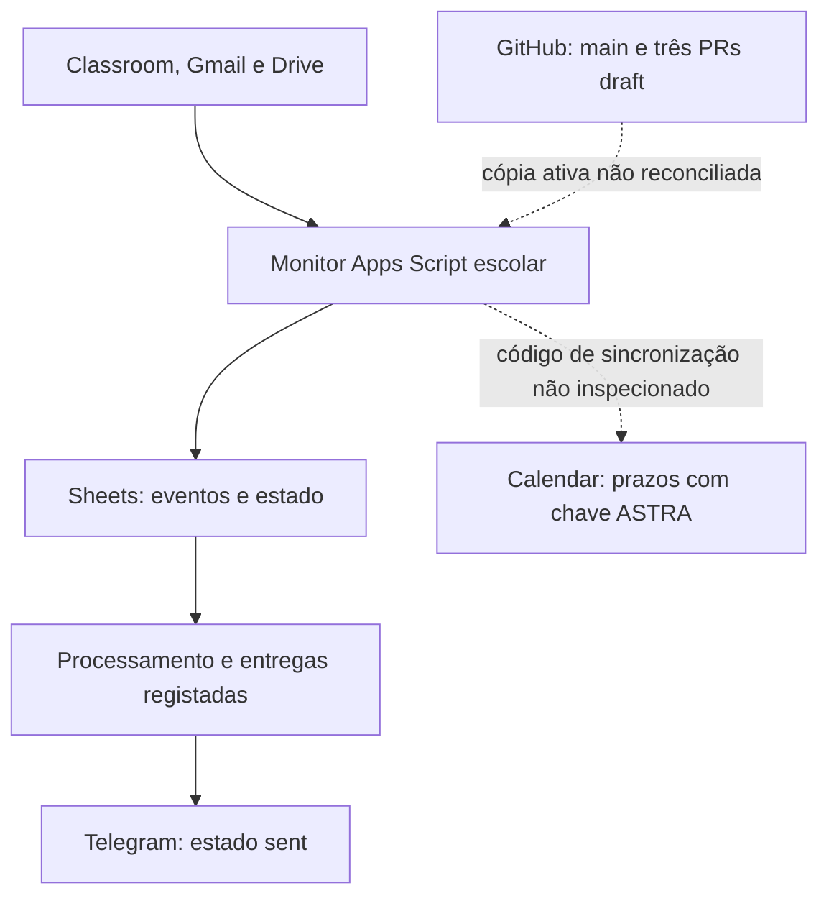

# ASTRA — Auditoria técnica de 18 de novembro de 2026

## Resultado e âmbito

Auditoria de leitura do GitHub, das folhas de eventos escolares, das etiquetas Gmail e do calendário ASTRA. As alterações deste ciclo são exclusivamente código-fonte numa branch de revisão; não foram instaladas no Apps Script. Não foram alterados eventos, emails, propriedades, permissões, triggers ou credenciais.

**Limitação principal:** não foi possível abrir o editor do projeto Apps Script ativo. A navegação para o dashboard encaminhou para a página pública de documentação Google. A pesquisa Drive por projetos Apps Script não devolveu resultados. Isto não prova que o projeto não exista nem que a ASTRA tenha parado. O URL/ID exato do script não foi recuperado do histórico. Não foi possível auditar diretamente código ativo, manifest, propriedades, deployments, triggers, execução, consumo de quotas ou validade de segredos.

## Fontes e versões

- Repositório privado: https://github.com/kadigo36/astra-foundation
- `main`: `f48abf2f0f039ebe043a71569f7ecfb9b3400458`; README indica fundação v0.6 Python/FastAPI + React.
- PR #1: https://github.com/kadigo36/astra-foundation/pull/1 — monitoring v0.7, draft, base main.
- PR #2: https://github.com/kadigo36/astra-foundation/pull/2 — zero-cost v0.8, draft, base v0.7.
- PR #3: https://github.com/kadigo36/astra-foundation/pull/3 — multi-account v0.9, draft, base v0.8.
- Código Apps Script analisado: `google-apps-script/Code.gs`, commit `a41472ec91a863fb4f98a881cf77d8edc165ff7f` (branch v0.9).
- Sheet escolar: https://docs.google.com/spreadsheets/d/1lpi5L8WgPGfRfZ5QA-Ga8GocvNp1K0X0R80hgc4OA4k/edit?usp=drivesdk
- Abas confirmadas: Events, TelegramDelivery, MonitorStateV09, EventProcessing. Leitura de Events A1:Z160, TelegramDelivery A1:L160 e EventProcessing A1:H160. Contagens referem-se ao conjunto devolvido; folhas continuam a receber alterações.
- Calendário consultado: “ASTRA — Escola”, janela de 13/11/2026 a 19/12/2026. Conta Calendar ligada tem um calendário principal diferente das duas contas Drive; a relação de partilha com a execução escolar não foi auditada.
- Histórico de conversas: fonte secundária, usada apenas para localizar componentes e recuperar alegações anteriores. Não substitui código ou logs atuais.

## Inventário e evidência

| Componente | Estado sustentado | Evidência e limite |
|---|---|---|
| Classroom | Atividade recente confirmada nos registos | 5 eventos; registos em 18/11. Não houve comparação integral com trabalhos atuais nem teste de paginação. |
| Gmail importante | Deteção e processamento registados | 52 linhas para 51 IDs de mensagem; inclui incidente histórico e mensagem de 18/11. |
| Drive | Atividade recente confirmada nos registos | 80 linhas; eventos de criação/atualização, último observado às 10:13 de 18/11. |
| Sheets / EventProcessor | Persistência e classificação registadas | 137 eventos e 137 classificações; todas as linhas de processamento devolvidas têm estado classified. Não é prova de interpretação Gemini. |
| Telegram de saída | Entregas registadas | 118 linhas sent, com Message ID, entre linhas de origem 21 e 138. Não houve envio de teste nem consulta direta da API Telegram. |
| Deduplicação | Parcialmente sustentada | 132 chaves de evento preenchidas, sem repetições; 118 chaves Telegram sem repetições. Primeiras 5 linhas Events sem chave. Um ID Gmail surge duas vezes em datas diferentes. |
| Calendar | Integração materializada confirmada | Dois eventos com link Classroom e ASTRA_CLASSROOM_KEY; prazos em 16 e 18/11. Não prova cobertura, atualização contínua ou remoção de trabalhos entregues. |
| Organização Gmail | Etiquetas existentes; automatismo por validar | Etiquetas escolares, projetos, segurança, promoções e outras. Não foi possível inspecionar filtros ou código classificador com as ferramentas de leitura disponíveis. |
| Triggers 15 minutos | Compatível com cadência dos registos | Intervalos próximos de 15 minutos; número, proprietário e configuração dos triggers não inspecionados. |
| Gemini | Teste histórico; estado atual por validar | Histórico refere ASTRA ONLINE e gemini-3.5-flash-lite. Sem chamada à API neste ciclo; disponibilidade atual e enquadramento gratuito não confirmados. |
| Leitor Docs/Sheets/PDF/DOCX/texto | Testes históricos; código ativo por validar | Não representado nos quatro ficheiros Apps Script da branch v0.9. |
| Multi-conta | Arquitetura e protótipo existentes | v0.9 propõe instância/folha privada por conta; não há evidência suficiente de várias instâncias operacionais. |
| Memória e agentes | Fundação documentada no main | Árvore inclui API/módulos de memória e agentes; conteúdo e deployment desses módulos não foram auditados neste ciclo. |
| Conversação Telegram, WhatsApp, Notion, planeamento diário | Não comprovados no âmbito acessível | Não concluir inexistência apenas por ausência no protótipo do repositório. |

## Arquitetura observada e relações por verificar

A folha ativa usa 9 colunas: Detected at, Provider, Title, Metadata, External ID, Source date, Open, Event key, Change type. O protótipo v0.9 também usa 9 colunas, mas com significados diferentes: inclui Account ID/Account type e não inclui Event key/Change type. **Copiar o protótipo sobre o projeto ativo pode corromper a interpretação dos dados e eliminar módulos recentes.**

## Problemas prioritários

1. **Divergência entre fonte e execução.** Main é v0.6; Apps Script v0.9 permanece num PR draft; a folha ativa demonstra funcionalidades adicionais. Não existe neste ciclo um snapshot verificável do projeto ativo nem um caminho de rollback comprovado para esse projeto.
2. **Incidente retroativo Gmail confirmado.** Em 16/11 foram detetadas e enviadas 50 mensagens anteriores a essa data, incluindo mensagens de maio. Um ID previamente registado em 14/11 voltou a surgir. Histórico secundário refere uma barreira aplicada às 14:39 de 16/11; nas linhas lidas não aparecem novos lotes históricos posteriores e há uma mensagem recente em 18/11. Portanto não se afirma que o bug continue ativo. Hipóteses a testar no código real: mudança de esquema/chave, perda de baseline ou alterações de etiquetas tratadas como receção. Causa não confirmada.
3. **Reconhecimento antes da persistência no protótipo v0.9.** `recordNewItems_` guardava seen IDs antes de appendEvents_. Uma falha na escrita podia impedir recuperação futura. Não extrapolar esta falha para a versão ativa: o histórico já menciona uma correção semelhante.
4. **Substituição silenciosa da folha no protótipo.** Qualquer erro ao abrir o ID configurado criava uma folha nova. Uma falha temporária ou de permissões podia separar histórico de estado. Corrigido apenas na branch de revisão.
5. **Limites e recuperação incompletos no protótipo.** Sem paginação Classroom/Gmail/Drive, sem retries HTTP controlados; Gmail consulta apenas IMPORTANT; seleção por ID não estabelece por si uma política temporal para alertas. `seenLimit: 2000` não considera o limite de bytes por propriedade. Histórico longo deixa de caber antes de atingir 2000 IDs. Estes pontos requerem reconciliação com o ativo antes de corrigir produção.

## Correções seguras realizadas neste ciclo

Na branch de revisão derivada de v0.9:

- Persistir eventos e executar SpreadsheetApp.flush antes de reconhecer IDs.
- Evitar uma segunda linha após falha entre persistência e reconhecimento, consultando identidade persistida por conta + provider + External ID.
- Remover IDs duplicados dentro da mesma resposta antes de escrever.
- Rejeitar estado seen inválido preservando o valor existente.
- Falhar explicitamente perante esquema incompatível da folha.
- Preservar o ID de uma folha configurada que esteja temporariamente inacessível.
- Acrescentar testes de falhas e recuperação à validação Apps Script.

Não foram modificados `runMonitoringCycle`, scopes OAuth, eventos existentes, propriedades ou triggers ativos. Não foi implementada uma segunda barreira Gmail sem consultar a correção anterior.

## Testes e resultados

Executados localmente em 18/11/2026, Node 24.22.3:

- `node --test google-apps-script/tests/*.test.cjs`: **12 aprovados, 0 falhas**.
- Casos: ordem append/flush/ack; falhas append/flush/propriedade; retry sem duplicação; isolamento por conta/provider; duplicação na resposta; folha inacessível; esquema incompatível; estado inválido; baseline inicial; exclusão de execução concorrente; libertação do lock após falha.
- `node --check --input-type=commonjs < google-apps-script/Code.gs`: aprovado.
- `python3 -m json.tool google-apps-script/appsscript.json`: aprovado.

Os testes usam mocks locais e não fazem pedidos Google, Gemini ou Telegram. Não simulam todas as garantias transacionais reais do Sheets; não equivalem a teste de produção. Node local difere do V8 Apps Script; não foram introduzidas dependências de Node no Code.gs. O workflow continua com Node 22; resultado remoto ainda por verificar quando publicado.

## Segurança, quotas e orçamento

- Não foram lidos ou copiados tokens/chaves. Os ficheiros Apps Script inspecionados não contêm credenciais literais. Isto não é uma auditoria de segredos de todo o histórico Git nem das propriedades ativas.
- Manifest v0.9 usa gmail.metadata e drive.metadata.readonly; não permite inferir as permissões do projeto ativo. Classificação de corpo e aplicação de etiquetas poderão exigir permissões adicionais; não alterar scopes sem aprovação.
- Google documenta 9 KB por valor de Properties e 500 KB por store, 6 minutos por execução e limites diários de runtime de triggers dependentes da conta. Medir bytes/tempo antes de aumentar retenção ou adicionar trabalho a cada ciclo. Fonte: https://developers.google.com/apps-script/guides/services/quotas
- Scopes Gmail oficiais: https://developers.google.com/workspace/gmail/api/auth/scopes
- Telegram sendMessage devolve Message em sucesso; o registo de Message ID é evidência indireta, não prova independente de leitura pelo utilizador. Não ativar paid broadcast. Fonte: https://core.telegram.org/bots/api
- Não foram criados serviços pagos ou contas de faturação. Quotas e condições gratuitas do modelo Gemini ativo têm de ser verificadas na conta real antes de ampliar uso.
- A leitura de todo o histórico de identidades no protótipo pode crescer em custo de tempo; adequação deve ser medida antes de deployment. O monitor usa ScriptLock no ciclo, mas chamadas diretas às funções privadas não adquirem esse lock.

## Cinco próximas tarefas, por ordem

1. **Recuperar snapshot do Apps Script ativo.** Obter URL/ID exato, ficheiros completos sem segredos, manifest, lista de triggers/proprietários, nomes das propriedades e últimas execuções. Guardar versão para rollback e reconciliar com v0.9 antes de qualquer instalação.
2. **Validar a barreira Gmail já aplicada.** Em teste isolado: email novo; alteração de etiquetas num email antigo; retry após falha; reinício; estado legacy; duas execuções concorrentes. Identidade de mensagem não deve depender de etiquetas. Preservar todos os IDs e não reprocessar histórico em massa.
3. **Validar persistência e entrega do ativo.** Confirmar locks e ordem de confirmação, reconciliar Events/EventProcessing/TelegramDelivery, distinguir tentativa de entrega de entrega confirmada e definir tratamento de timeout incerto sem prometer exactly-once entre Sheets e Telegram.
4. **Concluir organização Gmail com dry-run.** Inventariar filtros, reutilizar etiquetas atuais, regras determinísticas e correções do utilizador; só depois fallback semântico mínimo. Apresentar amostra de classificações antes de aplicar. Sem apagar, arquivar sensíveis ou alterar histórico em massa; mudança OAuth exige aprovação.
5. **Fechar cobertura Calendar e contas.** Comparar trabalhos com prazo às entradas e testar alteração de prazo, entregue/cancelado e idempotência. Confirmar acesso e origem por conta. Preparar plano de centralização com minimização, retenção e autorização explícita antes de transferir informação.

## Backlog após estabilização

- Observabilidade: run ID, conta de origem, duração, contagens, estado de paginação e erros sem corpos/segredos.
- Retries: backoff limitado apenas para operações seguras; respeitar 429/retry_after; evitar repetição cega de efeitos externos em timeouts.
- Conversação Telegram: allowlist de utilizador/chat, intenções separadas de execução, consultas read-only primeiro e confirmações vinculadas à ação concreta para escrita sensível.
- Memória: preferências e correções mínimas por identidade, retenção configurável, exportação/eliminação e sem conteúdo sensível por defeito. Política ainda por aprovar, não ativada.
- Planeamento diário, relatórios e integrações adicionais só após validação da base.

## Gate para alterações em produção e rollback

O PR contém fonte de revisão, não é um pacote para substituir diretamente a ASTRA escolar. Não fazer merge automático dos três PRs anteriores nem copiar Code.gs sobre o ativo. Após recuperar o snapshot, preparar diff por módulo, testes isolados e rollback para essa versão exata. Pedir aprovação antes de mudanças OAuth, estado/dados, novos triggers, migração entre contas ou substituição de componentes críticos. Reverter esta proposta no Git não reverte dados Google; nenhum dado Google foi alterado neste ciclo.
