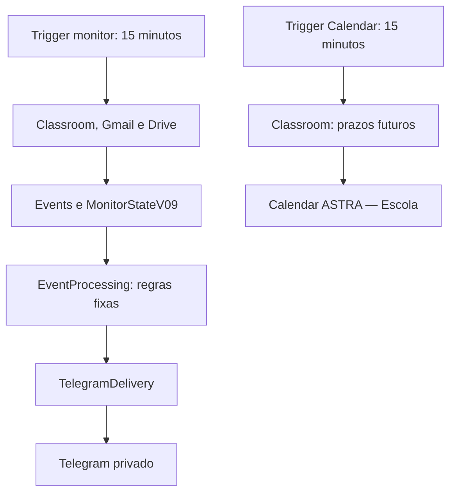

# ASTRA — Auditoria técnica atualizada de 18/11/2026

## Conclusão

O acesso ao projeto escolar foi recuperado. O código instalado está mais avançado
do que o protótipo v0.9 do GitHub. Não substituir o ativo pelo protótipo. Neste ciclo
foram guardados snapshot, testes e duas propostas para revisão; nada foi instalado
na Google. A auditoria inicial limitada foi substituída por estas conclusões.

## Fontes

- Projeto: https://script.google.com/home/projects/18XTTP6tHIr6ciGEsFh6TjHtmEfYdeeUpLHzE_7ScFqvgg0mbv7SP2Q-X/edit
- Execuções: https://script.google.com/home/projects/18XTTP6tHIr6ciGEsFh6TjHtmEfYdeeUpLHzE_7ScFqvgg0mbv7SP2Q-X/executions
- Folha: https://docs.google.com/spreadsheets/d/1lpi5L8WgPGfRfZ5QA-Ga8GocvNp1K0X0R80hgc4OA4k/edit?usp=drivesdk
- Snapshot de nove ficheiros: google-apps-script/live-school; hashes em snapshot.json.
- Main: f48abf2f0f039ebe043a71569f7ecfb9b3400458, fundação Python/FastAPI v0.6.
- PRs #1/#2/#3 permanecem draft, encadeados v0.7 → v0.8 → v0.9; sem merge.
- Revisão: https://github.com/kadigo36/astra-foundation/pull/4

Lidos integralmente os nove ficheiros, manifest, nomes das dez propriedades e
apenas os valores não secretos necessários. Tokens Gemini/Telegram confirmados
como configurados; valores não copiados. Snapshot não inclui dados ou propriedades.
A captura sequencial não é uma transação atómica do editor. A frase fixa de
emparelhamento no setup Telegram merece revisão antes de novas instalações; o
setup atual recusa substituir um chat já configurado.

## Inventário real

| Componente | Estado confirmado e limite |
|---|---|
| Classroom | Ativo, paginação até dez páginas por listagem, fingerprints para alterações. Último log: 89 trabalhos. |
| Gmail | Ativo, apenas IMPORTANT e até 50 mensagens sem paginação. Etiquetas participam no fingerprint; updated não é notificado como receção. |
| Drive | Ativo, 50 resultados por modifiedTime, sem paginação. Exclui folha de eventos; último log: 49 ficheiros após exclusão. |
| Persistência | MonitorStateV09 append-only; evento + flush antes do estado, chaves determinísticas para recuperar o mesmo evento. Legacy ASTRA_SEEN_* preservado. |
| EventProcessor | Ativo, até 20 novas classificações por ciclo, prioridades fixas por provider. Não usa Gemini no ciclo normal. |
| Telegram | Ativo, baseline na linha 21, até dez tentativas por ciclo após classificação. Estados pending/sending/sent/review; sending/review não têm retry cego. |
| Barreira Gmail | Presente e válida: 16/11/2026 14:39:00 Lisboa. Só notifica created com sourceDate posterior ou igual. |
| Classroom → Calendar | Ativo, IDs determinísticos e validação de chave; cria/atualiza PUBLISHED com prazo futuro. Não consulta submissões nem reconcilia eventos removidos/cancelados. |
| Leitor Drive | Docs, Sheets CSV, PDF, DOCX e texto; 30 mil caracteres e 10 MiB binários verificados depois do download. Sem limite descomprimido DOCX. |
| Gemini | Código e testes manuais, modelo configurado gemini-3.5-flash-lite. Não chamado neste ciclo; disponibilidade/quota atual por confirmar. |
| Organização Gmail | Nenhum dos nove módulos aplica etiquetas. Manifest tem gmail.readonly. Etiquetas existem, mas filtros externos não foram auditados. |
| Prioridades por prazo/submissão | Funções e testes existem; não integrados na prioridade persistida pelo processador regular. |
| Conversação Telegram | Sem doPost/doGet ou receção contínua; getUpdates apenas no emparelhamento. |
| Multi-conta | Instância school e Calendar pessoal já partilhado. Não equivale a monitorizar várias contas. Sem migração neste ciclo. |
| Memória, WhatsApp e Notion | Sem implementação nestes módulos. Fundação Python do main é separada e deployment não confirmado. |

## Arquitetura ativa

Exatamente dois triggers escolares, um por função, ambos a cada 15 minutos.
Partilham ScriptLock. Diálogos de edição cancelados sem guardar.

## Registos e incidente histórico

- 18/11 11:28:10: monitor concluído em 47,209 s. Log interno: Classroom 89, Gmail 50,
  Drive 49, todos sem erros e sem novos eventos/alterações. Processamento: 138
  eventos, todos classificados, zero inválidos. Telegram: sent 0, review 0,
  skipped 119. Skipped inclui eventos já tratados e não significa falha.
- 18/11 11:20:30: Calendar concluído em 8,967 s; scanned 1, unchanged 1, created 0,
  updated 0, errors 0. A primeira auditoria incluía também um prazo passado.
- 18/11 05:28:10: Falhou; painel mostra 1919,971 s e, às 06:00:10, apenas
  “Ocorreu um erro do servidor. Aguarde alguns instantes e tente novamente.”
  Causa interna desconhecida; duração apresentada não prova CPU efetiva.
  Execuções posteriores concluíram.
- Taxas no painel: monitor 0,76%, Calendar 0%. Falhas de providers são capturadas;
  Concluído pode ocultar falhas parciais, pelo que é necessário analisar o JSON.
- Incidente de 16/11 confirmado na folha: 50 emails antigos e um ID repetido em
  datas diferentes. O cutoff atual é posterior ao lote. Código e testes confirmam
  agora a barreira; não há evidência de continuação desse incidente.

## Segurança, permissões e orçamento

Manifest ativo: external_request, script.scriptapp, spreadsheets,
classroom.courses.readonly, classroom.coursework.me.readonly, gmail.readonly,
drive.readonly e calendar.events. Nenhum scope foi alterado.

Segredos obtidos de Script Properties, identidade Google escolar, sem partilha
de tokens entre contas. Teste PDF pode enviar conteúdo real ao Gemini se executado
manualmente; não foi executado. Não foram criados serviços pagos ou faturação.
Quotas reais da conta e Gemini não consultadas. IDs novos são guardados em Sheets,
não na propriedade limitada; leituras integrais do histórico precisam de orçamento.

Referências oficiais:
- https://developers.google.com/apps-script/guides/services/quotas
- https://developers.google.com/workspace/gmail/api/auth/scopes
- https://core.telegram.org/bots/api

## Problemas e alterações preparadas

1. Fonte divergente: snapshot exato em pasta separada; os dois esquemas de nove
   colunas têm significados diferentes. Não instalar o protótipo sobre o ativo.
2. Cutoff ausente aceita zero: fragilidade latente reproduzida com transporte mock.
   A propriedade atual existe; não está demonstrada falha atual. Preparada
   validação fail-closed em candidates/TelegramNotifications.gs, sem redefinir
   cutoff, fila, chaves ou estados. Instalação aguarda aprovação.
3. Organizador ausente: candidates/GmailOrganization.gs prepara preview read-only,
   preservação de classificações e correções por ID na função pura. Ambíguos vão
   para revisão, sem Gemini; interface/persistência de correções ainda em falta.
4. Polling incompleto: Gmail/Drive só primeira página; etiquetas geram alterações;
   tabelas integrais relidas. Preparar cursor/history ou paginação com limite de
   tempo antes de ampliar carga.
5. Observabilidade/retries: falta backoff limitado para leituras; Calendar regista
   contagem de erros sem detalhes; Telegram exige revisão em casos incertos.
   Nunca repetir cegamente envios após timeout.
6. Calendar: faltam estado de entrega, cancelamento e remoção de prazo; validar
   rigorosamente datas sem hora. Alterar/apagar eventos requer plano e aprovação.

## Validação deste ciclo

- Sintaxe dos oito módulos gs capturados, dois candidatos e manifest: válidos.
- 22 testes live-school aprovados: hashes dos nove ficheiros, cinco suites puras
  existentes, ordem de persistência/flush, recuperação sem duplicação, locks,
  folha indisponível, cutoff real, mudanças de etiquetas, fragilidade latente e
  correção proposta, estados Telegram e identidade Calendar.
- Regras Gmail: domínio escolar, lookalikes, segurança, preservação/correção e
  fronteira temporal; baseline ausente bloqueia antes da API.
- Ensaio em memória de 20 emails recentes da escola, sem corpos/anexos: 17 elegíveis,
  oito classificações existentes preservadas, nove para revisão, zero propostas
  automáticas. A barreira histórica Telegram foi usada só no ensaio local.
  Amostra parcial; não é medição de precisão ou organização integral da caixa.
- Testes usam mocks, sem rede Google/Gemini/Telegram. Suites existentes executadas
  localmente; nenhuma função de escrita foi executada no projeto Google.
  Validação dos candidatos em runtime Apps Script ainda pendente de instalação.

## Cinco próximas tarefas

1. Rever a validação Telegram e verificar hashes atuais antes de instalar,
   preservando o cutoff existente.
2. Instalar só preview Gmail e definir início não retroativo, testar amostra
   read-only e recolher correções antes de aplicar etiquetas.
3. Medir duração/quotas, estruturar erros e retries de leitura e cobertura
   incremental Gmail/Drive sem mudar os triggers.
4. Validar Calendar para entregues/cancelados e mudança/remoção de prazo;
   apresentar política e rollback antes de escrita.
5. Acrescentar comandos Telegram read-only e memória mínima por identidade,
   allowlist, retenção e confirmação específica para efeitos sensíveis.

## Aprovação concreta e rollback

Proposta: instalar apenas validação Telegram e módulo novo de preview Gmail,
definindo exclusivamente ASTRA_GMAIL_ORGANIZER_START_MS no instante da instalação.
Não muda OAuth, não aplica etiquetas, não arquiva, não apaga e não altera triggers
ou runMonitoringCycle. Nenhum destes passos foi executado neste ciclo.

Rollback: restaurar só TelegramNotifications.gs do snapshot e remover módulo novo.
Sem migração de dados. Propriedades existentes e filas preservadas. A aplicação
futura de etiquetas exigirá aprovação separada para gmail.modify e operações.
